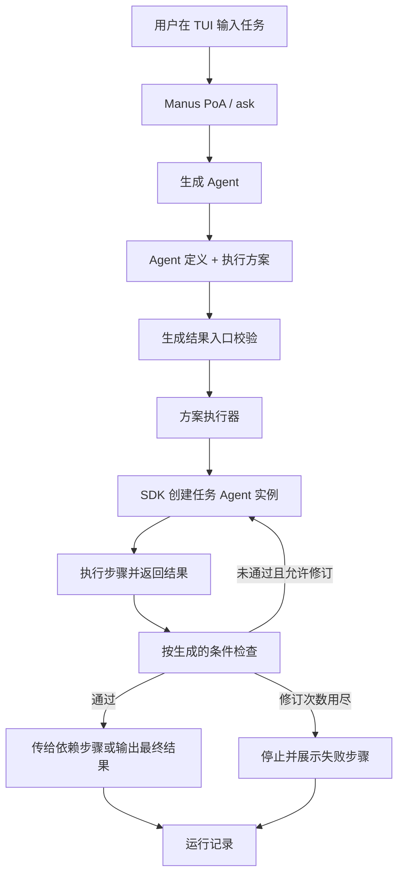

# Manus Demo V1 设计

日期：2026-11-11（第一阶段验收范围已更新）  
状态：设计与首版代码骨架；真实模型联调、业务场景验收按实施计划推进  
开发仓库：`Manus-brainary`  
运行基线：Brainary、PoA SDK、WM SDK `0.2.0-rc`

## 1. 产品目标与交付形式

Manus 根据用户任务生成任务 Agent 的定义和执行方法，并通过 Brainary 创建 Agent 实例，执行生成的方法，交付结果。

面向产品与演示的表述：

> Manus 是运行在 Brainary 上的 Agent 生成与任务执行应用。用户提交任务后，Manus 生成合适的 Agent 和执行方案，组织执行并展示结果。

“PoA 生成 Agent”可以作为工程简称。完整实现链路是：**Manus PoA 调用生成 Agent，生成 Agent 定义与执行方案，再由 PoA 通过 SDK 创建任务 Agent 实例并执行。** 生成内容依赖模型；编排代码负责输入、调用、数据流和生命周期。

主交付物为 `dist/manus.poa`。用户在 Brainary TUI 中通过 `/poa fg <绝对路径>/manus.poa` 启动。任务输入使用 SDK `ask`。第一版无需额外 Web 页面或独立输入服务。

### 1.1 两阶段范围

| 阶段 | 交付能力 | 验收依据 |
| --- | --- | --- |
| 第一阶段 A：生成与执行闭环 | 生成 Agent 定义、生成执行方案、创建实例、按生成方案执行、检查与有限修订、展示运行记录 | 更换任务或生成方案后，角色、步骤与数据依赖随之改变；得到可核查结果 |
| 第一阶段 B：执行资产导出 | 保存生成产物与运行记录；将已验证的任务定义与方案导出为可独立运行的任务 `.poa` | 再次启动任务包时可以执行已保存的流程，无需重新生成方案 |
| 第二阶段：RSI | 基于任务反馈形成候选改进，比较新旧版本，选择有效改进并复用 | 同一验收集上有新旧方案、执行数据、效果比较和版本选择记录 |

第一阶段由 A、B 两个开发增量组成，交付人工验收时必须全部完成。Manus 运行过程直接产出可独立执行的任务 `.poa`，并保存生成与执行轨迹；只展示 JSON 或只提供离线打包命令不能通过第一阶段验收。

第一阶段 A 满足两项核心生成要求：Agent 的角色、提示词、知识上下文、工具选择，以及执行步骤、依赖、验收条件和纠错策略。第一阶段 B 补齐可分发执行程序。自由生成 JavaScript 不是首版主路径。

### 1.2 当前骨架交付范围

源码已提供第一阶段 A 的主流程和 SDK 调用位置：`ask`、生成结果契约、结构化方案执行、文本结果检查、至多一次修订、运行记录输出。

当前默认工具列表为空，以文本任务验证通路。模型使用本机已配置的 `custom / gpt-5.6-sol`，在 `src/config.ts` 修改。业务场景与工具清单随后确定；凭据由 Brainary 配置管理。

开发起点为上述骨架。本次第一阶段开发包含真实模型联调、过程与产物留痕、WM 接入及任务包自动导出；全部完成后交由用户人工验收，再进入第二阶段。

## 2. 开发方式：轻量 SDD

采用 **Spec-driven development（规格驱动开发）＋纵向小步交付**。每个开发任务有明确输入、输出、实现范围和验收方法，coding agent 按任务实现并验证。

| 方式 | 适用性 | 本项目选择 |
| --- | --- | --- |
| 轻量 SDD | 契约先行，按可运行流程分步实现，设计与代码同步维护 | 采用 |
| 完整 SDD 框架与多级模板 | 多团队或较大项目需要统一治理时使用 | 当前沿用模板工具链即可 |
| 仅凭对话逐次写代码 | 适合局部探索；跨会话较难保持术语、接口和验收一致 | 调研可以使用，正式实现以本设计为准 |

仓库内保留三类开发依据：

1. `AGENTS.md`：通用开发规则与范围约束。
2. 本文：术语、行为、契约、实现设计、验收标准。
3. `docs/plans/manus-demo-v1.md`：按交付结果拆分的实现任务与验证步骤。

开发循环：阅读相关设计和任务 → 实现一个完整小步骤 → 运行对应测试与构建 → 更新完成状态。接口、产物格式或展示流程变化时同步更新设计。普通实现细节直接处理；新增产品能力、扩大范围时记录并与用户讨论。

测试优先覆盖产物解析、依赖传递、执行顺序、修订与失败停止。真实 SDK/模型联调用独立运行验证；模型替身仅用于稳定验证本地控制流程。无需为每个转发函数单独写测试。

## 3. 核心概念

| 概念 | 本项目中的含义 | 生命周期 |
| --- | --- | --- |
| Manus PoA | `src/main.ts` 构建出的 JS 程序，组织整个生成与执行过程 | 每次启动运行一次 |
| 生成 Agent / 外层 Agent | 根据任务生成定义和执行方案的 Agent | 生成时由 SDK 创建、运行、关闭 |
| Agent 定义 | 名称、职责提示词、知识上下文、工具选择等数据 | 可记录、修改、复用 |
| 任务 Agent / 内层 Agent | 根据生成定义由 SDK 创建的实际执行实例 | 当前骨架每次任务步骤调用创建，执行后关闭 |
| 执行方案 | 步骤、角色引用、数据依赖、验收条件和修订次数 | 由生成 Agent 产出，执行器读取 |
| 结果检查 Agent | Manus 的固定辅助角色，按条件审查步骤返回的文本 | 每次检查创建并关闭 |
| `.poa` 包 | 程序及其运行资源的分发包 | 构建或导出时产生 |

外层、内层描述职责分工。当前生成 Agent 和任务 Agent 都由 Manus PoA 创建；不把这种分工等同于运行时父子线程关系。

Agent 定义 ID（例如 `writer`）用于方案内部引用；SDK 返回的 `agent_id` 标识运行实例。同一定义可创建多个实例，两个 ID 不混用。

包中可以携带 Agent 定义数据，运行实例由 Runtime 创建。PoA 程序、定义数据、运行实例分别描述。SDK 导出的 `PoA` 类是记忆接口，不是执行另一个任务包的启动器。

## 4. 总体架构



### 4.1 首版选择：生成结构化方案，由固定执行器解释执行

执行器固定的是语义：如何创建 Agent、如何传递结果、如何检查和修订。角色、步骤数量、执行指令、数据依赖和验收条件来自生成产物。

例如，任务一生成“提取 → 汇总”，任务二生成“比较 → 起草 → 修改”。执行器源码不变，但实际执行方法不同。因此，固定执行器不等于固定业务流程。

首版支持按顺序执行的步骤及前置结果引用。`inputFrom` 表达数据依赖，数组顺序表达执行顺序。方案不增加并行调度、任意条件分支或循环语法。确实出现对应场景时再扩展契约与执行器。

### 4.2 单 PoA 与双 PoA 的位置

| 使用方式 | 程序组织 | 适用需求 |
| --- | --- | --- |
| 当前单包运行 | Manus PoA 内完成生成，读取生成的方案并调用任务 Agent | 一次任务的完整生成与执行演示 |
| 导出任务 PoA | Manus 产出 Agent 定义、方案和运行入口，形成另一个任务包 | 复用、分发、独立重跑已生成的方法 |

双 PoA 的收益来自任务资产的独立生命周期：可以分别版本化、交付、回归和复用。它并不自动提高 Agent 的能力，也不要求所有任务 Agent 的实现代码由模型从零生成。

当前“生成 Agent”具体指生成 SDK 可实例化的定义，而不是生成模型权重或另一个 Agent Runtime。生成方法可以配合已有执行器运行。任务包导出可将定义与方案固化在新程序中，同样形成可运行程序资产。

## 5. 代码布局

```text
src/
  main.ts           Manus PoA 入口与正常主流程
  input.ts          ask 输入与一次性输入校验
  config.ts         模型、可用工具和单次 Agent 执行时限
  contracts.ts      生成产物、执行结果和运行记录类型
  bundle.ts         JSON Schema、模型输出解析与引用校验
  generator.ts      生成 Agent 的提示词与生成调用
  execution.ts      按生成方案执行、检查、修订与结果传递
  agent.ts          SDK 的创建、等待、结果读取和关闭
tests/
  fixtures/bundle.json  可执行方案样例，用于契约与流程验证
  bundle.test.ts        生成结果入口契约
  execution.test.ts     真实执行器的控制流程
scripts/                继承模板的打包与可选输入 Schema 工具
manifest.toml           Manus 包声明
docs/design/            开发设计
docs/plans/             分步实施计划
docs/research/          SDK 接口与输入通道的调查证据
dist/                   自动生成的 main.js 与 manus.poa
```

按职责拆分，不另建框架层：`generator` 负责“生成什么”，`execution` 负责“如何运行方案”，`agent` 集中 SDK 生命周期。它们通过 `contracts` 协作。

`AgentRunner` 是生成器、任务执行和结果检查共用的一种调用签名。测试只替换这个模型边界，继续运行真实方案执行器。当前无需创建 `BaseAgent`、插件注册表或多个 Provider 适配层。

提示词与对应逻辑放在同一模块中，通过构建进入包。未来提示词需要独立版本管理时再拆文件。当前没有业务逻辑的目录不预先创建。

## 6. 数据契约

### 6.1 输入与环境

`TaskRequest`：

| 字段 | 类型 | 含义 |
| --- | --- | --- |
| `description` | string | 用户提交并去除首尾空白后的任务正文 |

`ManusConfig`：

| 字段 | 类型 | 当前配置 |
| --- | --- | --- |
| `model` | SDK `ModelSpec` | `custom / gpt-5.6-sol` |
| `availableTools` | `BrainaryTool[]` | 空列表，先完成文本通路 |
| `agentTimeoutMs` | number | 单次 Agent 调用总等待时限 180 秒 |

工具清单是 Manus 任务环境提供的能力目录，不是模型自行发明的工具。确定业务场景后，把所需且 Runtime 已提供的工具加入配置，生成 Agent 再按角色选择子集。

### 6.2 生成产物 GeneratedBundle

| 字段 | 类型 | 含义 |
| --- | --- | --- |
| `version` | `1` | 当前契约版本 |
| `summary` | string | 方案摘要 |
| `agents` | `AgentDefinition[]` | 本次生成的任务 Agent 定义，至少一个 |
| `steps` | `ExecutionStep[]` | 实际执行顺序，至少一个；末步骤返回最终答案 |

`AgentDefinition`：

| 字段 | 含义 |
| --- | --- |
| `id` | 定义标识，在当前 bundle 内唯一 |
| `name` | 角色显示名称 |
| `systemPrompt` | 该角色的职责、方法和输出要求 |
| `knowledge` | 从输入提炼的任务上下文；通过提示词传给实例 |
| `tools` | 从当前能力目录选择的 SDK 工具 |

这里的 `knowledge` 是任务上下文，不承担知识检索或长期记忆。WM 集成按 SDK 的记忆接口实现。

`ExecutionStep`：

| 字段 | 含义与执行规则 |
| --- | --- |
| `id` | 步骤标识，在当前 bundle 内唯一 |
| `agentId` | 引用 `agents[].id`，不是 Runtime 实例 ID |
| `instruction` | 此步骤执行的具体指令 |
| `inputFrom` | 所需前置步骤 ID；其已通过检查的输出进入当前消息 |
| `acceptanceCriteria` | 用于检查结果的条件，至少一条 |
| `maxRevisions` | `0` 或 `1`；检查不通过后允许的修订次数 |

样例见 `tests/fixtures/bundle.json`，类型见 `src/contracts.ts`，运行校验与生成提示词共用的 Schema 在 `src/bundle.ts`。

入口依次完成 JSON 解析、形状校验、语义校验：ID 唯一、角色引用存在、输入引用在此前步骤中、工具位于当前目录。之后执行器只接收 `GeneratedBundle`，不重复验证。

### 6.3 执行与记录

`AgentRunner(definition, message) -> Promise<AgentReply>` 返回 Runtime 实例 ID 与最终文本。

`Review` 包含 `passed: boolean` 和 `feedback: string`。当前检查由独立模型调用根据文本证据完成。场景验收所需的文件、命令或数据正确性检查，随场景接入；模型判断和客观校验分别记录。

每个 `StepRecord` 保存步骤 ID、通过或失败状态，以及所有尝试。每次尝试保存任务 Agent 实例 ID、输出、检查 Agent 实例 ID和检查结果。

`ExecutionResult` 保存整体状态、步骤记录和 `finalOutput`。步骤最终未通过时状态为 `failed`，`finalOutput` 为 null；部分产物仍在步骤记录中。

`RunRecord` 聚合原始任务、生成产物和执行结果。当前通过 `text` 输出，供 TUI 查看；此输出不等同于已经完成 WM 持久化。

## 7. 主流程与执行语义

### 7.1 一次运行

1. 在 TUI 前台启动 `manus.poa`。
2. `readTask()` 调用 `ask`，读取自由文本并校验非空。
3. `generateBundle()` 创建生成 Agent，请求符合契约的 JSON。
4. `parseBundle()` 在模型数据进入系统时完成一次校验。
5. `notify` 展示生成的定义与方案。
6. `executeBundle()` 按 `steps` 顺序运行，每步读取指定前置结果。
7. 每步执行后检查返回文本；不通过且允许修订时，携带原任务、上次输出和检查反馈重新执行一次。
8. 步骤通过后发布结果给下游；最终失败时停止执行后续步骤。
9. 输出最终答案及完整运行记录。

`ask` 的回答来自返回值 `answers[].text`，不依赖 `POA_INPUT`。当前包不声明额外输入 Schema。

### 7.2 实例生命周期

当前骨架在每次 `AgentRunner` 调用中创建一个实例，等待结果后关闭。任务修订使用相同定义创建新实例，通过消息显式传递此前输出和反馈。跨步骤数据由方案中的 `inputFrom` 传递，不依赖隐式会话历史。

这样便于直接观察“生成定义 → 创建实例 → 完成步骤”的关系。后续需要同一实例保留多轮上下文时，可以在既有定义与计划契约下调整生命周期。

SDK 默认等待约 30 秒，等待超时不代表执行结束。适配模块继续获取同一个实例的结果，不重新发送任务。达到配置的总时限后报告超时并关闭实例。

### 7.3 检查、修订与 RSI

首版每个步骤按生成的条件检查，通过则继续；未通过时遵循生成的 `maxRevisions`。这实现的是本次任务内的纠错。

RSI 在第二阶段增加跨运行的改进：生成候选方案或生成策略版本，在相同验收任务上比较，再决定保留哪一版。一次纠错成功不直接作为 RSI 已完成的依据。

### 7.4 失败处理

| 事件 | 当前处理 |
| --- | --- |
| 非交互环境调用 `ask` | 返回明确启动提示，使用 TUI 前台运行 |
| 空任务 | 入口拒绝，提示重新输入 |
| 生成 JSON、结构或引用不合法 | 停止并报告具体契约错误 |
| SDK 调用失败或 Agent 超时 | 保留 SDK/适配层错误，不自动重发整个任务 |
| 检查结果 JSON 不合法 | 停止并报告检查结果契约错误 |
| 业务检查不通过 | 按本步策略修订；用尽后记录失败并停止下游 |

不为未出现的故障建设统一重试系统。实际 SDK 缺陷用发布版本、最小复现、预期/实际结果和影响形成反馈。

## 8. SDK、Runtime 与 WM 分工

| 组件 | 本项目使用方式 |
| --- | --- |
| `brainary-poa-template` | 开发脚手架来源：TS、Biome、Vitest、Rolldown、`.poa` 打包脚本 |
| `@brainary/poa-sdk` | `ask`、`notify`、`text`、Agent 创建与执行；后续文件/工具调用 |
| `@brainary/wm-sdk` | 第一阶段 B 接入产物与运行记录持久化，第二阶段使用这些记录做改进 |
| Brainary `0.2.0-rc` | 加载 `.poa`，执行 V8 程序，提供 Agent 与工具运行能力 |
| Manus | 生成契约、提示词、执行方法、应用流程和验收 |

Node.js 用于安装、测试、构建和打包。PoA 程序运行在 V8 中，运行时代码不直接使用 Node 的文件和进程模块。后续需要文件或命令操作时通过已发布 SDK 工具调用。

## 9. 展示脚本

构建：

```bash
pnpm install --frozen-lockfile
pnpm lint
pnpm typecheck
pnpm test
pnpm package
```

启动 Brainary 0.2.0-rc，再在 TUI 输入：

```text
/poa fg /Users/notyourkay/Manus-brainary/dist/manus.poa
```

一次演示展示四件事：

1. **任务输入**：用户提出目标与交付要求。
2. **生成产物**：展示生成的角色定义，以及步骤、依赖和检查条件。
3. **实际执行**：展示哪个实例执行哪个步骤、上游结果如何传入下游、检查和修订结果。
4. **最终交付**：显示最终答案，必要时展开运行记录。

当前骨架以结构化 `notify/text` 输出这些信息。第一阶段 A 联调时补齐可读摘要与步骤开始提示；运行记录继续保留完整数据。

场景尚未确定。首次联调可用完全自包含的文本任务验证机制，例如把输入要求整理成指定格式。正式业务验收再接入对应工具与样本。

## 10. 任务包导出与资产复用

第一阶段 B 将 `GeneratedBundle` 和匹配版本的执行入口打包为任务 `.poa`。导出包的程序负责读取已有定义与方案，通过 SDK 创建实例并执行；它不再调用 Manus 生成 Agent。

首个导出版本复现同一个任务。需要把方法复用于同类新任务时，显式提取任务参数，并通过入口输入传入；不能把任务相关文本全部固化后仍称为通用方法。

Manus 构建时预先捆绑任务执行入口；运行时将生成的任务、Agent 定义和方案与该入口组合，自动写出可独立执行的任务 `.poa`。复用当前打包依赖和 SDK 文件/终端能力，用户不需要手工执行导出脚本。SDK `PoA` 记忆类不用于启动或编译程序。

持久化内容至少包括任务、Agent 定义、执行方案、运行结果、使用的配置与版本标识。WM 的 schema、写入、读取按 SDK 接口落地。导出文件与 WM 记录的具体接线在第一阶段 B 完成，不改变第一阶段 A 的生成与执行契约。

## 11. 验收标准

| 编号 | 验收项 | 方法 |
| --- | --- | --- |
| A1 | Manus 包能构建，Runtime 能加载 | 运行模板检查和 `pnpm package`；rc Runtime 加载检查 |
| A2 | 前台输入进入主流程 | TUI 实测 `ask` 输入与回显/生成调用 |
| A3 | 生成 Agent 定义与方法 | 真实模型返回可解析的 `GeneratedBundle`，包含角色、指令、依赖与条件 |
| A4 | 方案实际控制执行 | 改变生成的步骤、角色引用和依赖后，执行器调用与输入随之改变 |
| A5 | 检查和修订生效 | 未通过时携带反馈修订；无修订额度或仍失败时不执行下游 |
| A6 | 真实任务可用 | 选定业务样例满足预先给定的客观验收条件 |
| B1 | 产物可追溯 | 持久化的任务、定义、方案、结果与版本可读取并对应 |
| B2 | 任务方法可独立运行 | 导出任务包在新一次运行中复现结果，无需调用生成 Agent |
| R1 | RSI 有可比较的改进证据 | 同一任务集记录改进前后指标、候选方案和最终版本选择 |

当前自动测试覆盖 A4、A5 的执行逻辑，以及生成结果的入口校验。真实模型生成、工具调用与业务效果需要实测，不能由脚本化模型回复替代。

## 12. 已选决策

| ID | 决策 | 原因 |
| --- | --- | --- |
| D-01 | TUI 前台 `ask` 作为任务入口 | 已在 rc 版本验证交互链路，直接支持自然语言输入 |
| D-02 | WM/SDK 问题按应用使用反馈给对应层 | Manus 专注生成与执行应用 |
| D-03 | 轻量 SDD，复用模板工具链 | 为 coding agent 提供稳定契约和验收，保持开发流程简洁 |
| D-04 | `manus.poa` 作为主展示载体 | 与 Brainary 的运行形式一致 |
| D-05 | 结构化方案驱动固定执行器 | 前两类生成产物能直接控制执行，也便于独立验证与导出 |
| D-06 | 首版顺序执行、前置数据引用、最多一次修订 | 表达首轮闭环所需的方法，不先建设通用工作流引擎 |
| D-07 | 当前每次调用创建实例，显式传递上下文 | 实例生命周期与方案数据流清楚，便于观察生成行为 |
| D-08 | 任务包导出放在第一阶段 B，RSI 放在第二阶段 | 生成、资产复用与持续改进分别有清楚验收点 |

接口证据与 TUI 输入实测记录见 `docs/research/2026-11-11-demo-readiness.md`；后续任务见 `docs/plans/manus-demo-v1.md`。

## 13. 第一阶段人工验收边界

人工验收手册见 `docs/acceptance/phase-1.md`。用户输入自己的自然语言后，应获得完整任务 `.poa`、可阅读的定义/方案、输出结果和按时间排列的轨迹。另一次 Brainary 运行可直接执行该任务包，重新创建实例完成原任务，且不调用生成 Agent。第一版复用含义是原任务方法的独立重跑；同类新任务的参数化另行定义。

记录保存任务、生成原文、定义/方案、角色和实例对应关系、各次调用输入输出、检查/修订、时间、状态、模型与版本、资产标识和每次运行标识。应用导出文件是可交付资产与检查证据；WM 通过 SDK 保存当前运行状态并导出快照，跨运行复用通过资产与快照恢复，不能把构造 PoA 时的 agent_id 当作跨会话数据库键。

开发任务的人工契约附在实施计划各任务末尾。阶段验收后才开始 RSI。
